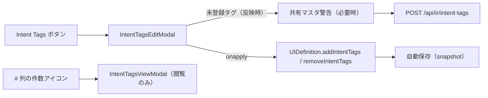

# ユースケース: Intent Tags

最終更新: 2026-10-05 02:05

## 概要

UI コンポーネントに「利用者の意図」を表す文字列タグ（例 `auto-layout`、`validator:email`、`depends-on:{logicalId}`）を付ける。  
Java のアノテーションや Rust の derive に近い位置づけで、IR は意味を解釈しない。解釈は将来 target ごとの writer-filter / テンプレートが担う。

| 項目 | 現状 |
|---|---|
| IR | `EditorComponent.intentTags?: string[]`（空なら key 自体を持たない） |
| 永続化 | snapshot YAML の各 component に `intentTags` として保存 |
| マスタ | `application.yml` の `ir.intentTags` で IR 種別ごとに YAML を合成 |
| GUI | Property の「Intent Tags」ダイアログ、`#` 列のタグ件数アイコン |
| Export | Raw の各フィールドへ `intentTags` を素通し。target 側の解釈は未実装 |

## タグ id の書式

- `name` または `name:arg`。`name` は小文字・数字・ハイフン（先頭は英数字）
- `arg` は `A-Z a-z 0-9 _ # . { } -`
- マスタ側の `{logicalId}` はプレースホルダ。候補表示では画面内の logicalId に展開し、`depends-on:customerName` は `depends-on:{logicalId}` の定義（説明）に一致する

正規化（trim・空除去・重複除去・順序保持）は `src/lib/ir/intent-tags.ts` の `normalizeIntentTags`。

## マスタ構成（`application.yml`）

```yaml
ir:
  intentTags:
    - irType: ui-definition
      files:
        - path: ./config/intent-tags-default.yaml
          alias: default
        - path: ./config/intent-tags-common.yaml
          alias: common
    - irType: layout
      files:
        - path: ./config/intent-tags-validators.yaml
          alias: validators
```

| キー | 規則 |
|---|---|
| `irType` | kebab-case。重複不可。いま GUI が使うのは `ui-definition` のみ |
| `files[].path` | アプリケーションパス解決（`resolveApplicationPath`）。空不可 |
| `files[].alias` | `[a-z0-9-]+`。同じ `irType` 内で重複不可。`default` が GUI からの登録先 |

マスタファイルは `tags` だけを持つ。IR 種別はファイルではなく設定側で決めるため、同じ YAML を複数の `irType` から参照できる。

```yaml
tags:
  - id: auto-layout
    description: 自動レイアウトの対象にする
  - id: 'validator:email'
    description: |
      メールアドレス形式を検証する
      （JSF の f:validator 相当）
```

### 合成

- `files` の順に読み、同じ id は先勝ち（後続は warn ログを出して捨てる）
- 存在しないファイルは空として扱う（default 以外は warn ログ）
- 形式不正（Zod 検証失敗）はエラー。Layout Editor の初期読込は止めず、ダイアログに `loadError` を出す
- 各定義は出所の `source`（alias）を持ち、候補・閲覧ダイアログに表示する

### 新規登録

- 登録先は対象 `irType` の alias `default`。未設定なら登録不可（タグの付与だけは行う）
- 既存コメントを保った YAML 文書へ追記し、一時ファイル経由で置き換える。親ディレクトリが無ければ作る
- default ファイルがほかの `irType` からも参照されている場合、登録前に警告する（「Intent TagsマスタがほかのIR種別 (Layout, …) からも参照されています」）
  - 「今後このメッセージを表示しない」は localStorage に保存する。キーは共有している IR 種別の組み合わせを含むため、共有先が増えると再度表示される

## GUI（Property）



- ヘッダの「Intent Tags」ボタンでダイアログを開く。選択件数をバッジで出す。0 件選択でも「すべて」操作のために開ける
- ダイアログ
  - 現在の付与状況: 選択中（無ければ全件）のタグを `tag n/m` のチップで表示。クリックで操作対象に追加。Tooltip に説明と出所
  - 操作するタグ: `TagsInput` に Obsidian 風の候補（前方一致 → 部分一致、出所バッジ、説明 1 行目）。書式違反は確定しない。未登録タグは黄色
  - 新規タグ: 未登録タグごとに説明を入力。見出しに登録先（`default`）と共有先を表示
  - 操作: 「選択に反映」「選択から削除」「すべて (N) に反映」「すべて (N) から削除」。反映時だけ未登録タグを登録する。登録に失敗したら反映しない
- 属性テーブル `#` 列: 運用コメント `#` の右に、タグがある行だけ件数アイコン。Tooltip にタグ一覧、クリックで `components[logicalId]` 見出しの閲覧ダイアログ

WARN: 「すべて」は列フィルタや「編集可能な項目のみ」に関係なく、全コンポーネントが対象。

`IntentTagsEditModal` は対象の種類を知らない（タグ配列の一覧と `scopes` を受け取る）。画面メタ（`ui-definition-meta`）へ付けるときもこのダイアログを再利用できる。

マスタの Context（`IntentTagCatalog`）は `layout-editor/+layout.svelte` の session `{#key}` の外で作るため、セッションを切り替えても登録済みタグが残る。

## Export

`mapComponentToRawField` が正規化済みで空でない `intentTags` を Raw フィールドへ写す。Raw JSON Schema は `additionalProperties: true` のため検証を通り、writer-filter から `items[].intentTags` として読める。shape / serialize は現状タグを出力しない。

WARN: 外部 UI 定義ファイルからの Import ではタグを復元しない。Export → Import の往復ではタグが失われる。

## HTTP API

[HTTP API](../api/http-endpoints.md) の「Intent Tags」を参照（`GET` / `POST /api/ir/intent-tags`）。

## 関連実装

| 領域 | パス |
|---|---|
| 正規化・候補・定義照合 | `src/lib/ir/intent-tags.ts` |
| IR スキーマ | `src/lib/ir/elements/component-schema.ts` |
| 付与 / 削除操作 | `src/lib/ir/ui-definition.ts`（`addIntentTags` / `removeIntentTags`） |
| 設定型 / parse | `src/lib/config/application-types.ts` / `src/lib/server/config/application-config-parse.ts` |
| マスタ読込・登録 | `src/lib/server/io/intent-tag-catalog-io.ts` |
| API | `src/routes/api/ir/intent-tags/+server.ts` |
| Context | `src/lib/store/layout-editor/intent-tag-catalog.svelte.ts` |
| ダイアログ | `src/lib/components/IntentTagsEditModal.svelte` / `IntentTagsSharedWarningModal.svelte` / `IntentTagsViewModal.svelte` |
| 件数アイコン | `src/lib/components/IntentTagsIndicator.svelte` |
| 候補付き入力 | `src/lib/components/TagsInput.svelte`（`suggestions` / `accept` / `tagColor`） |
| Raw への素通し | `src/lib/transform/ir-to-raw-fields.ts` |

## 関連ドキュメント

- [レイアウトエディタ編集](./layout-editor.md)
- [IR スナップショット自動保存](./ir-snapshot-auto-save.md)
- [外部 UI 定義の出力（Export）](./ui-export.md)
- [プラグイン](../architecture/plugins.md)
